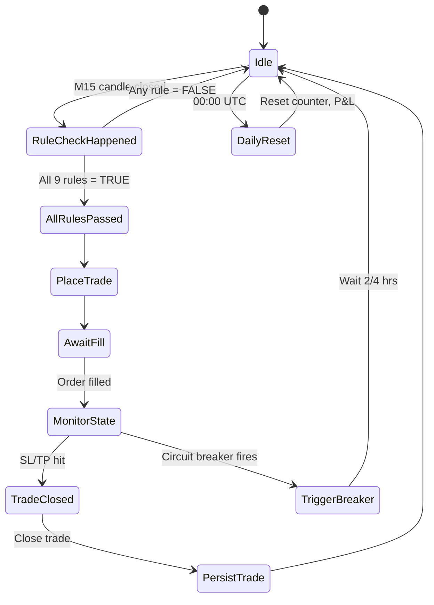

# Tradie — PRD Technical Appendix

> **Companion document to:** Tradie PRD v1.0.0-draft
> **Classification:** CONFIDENTIAL

---

## Appendix A: Environment Variables

| Variable | Required | Description |
|------------------------|----------|----------------------------------------------------------|
| `OANDA_API_KEY` | ✅ | OANDA REST API v20 access key |
| `OANDA_ACCOUNT_ID` | ✅ | OANDA account identifier |
| `OANDA_ENVIRONMENT` | ✅ | `practice` or `live` |
| `TELEGRAM_BOT_TOKEN` | ✅ | Token from BotFather |
| `TELEGRAM_CHAT_ID` | ✅ | Your personal user ID |
| `LOG_FILE_PREFIX` |        | Prefix for rotated log files, e.g., `tradie` |
| `NEWS_BLACKOUT_HOURS` |        | How many hours before/after news events to block (default: ±1) |
| `NEWS_SOURCE` | ✅ | Default: `forexfactory` |


---

## Appendix B: Data Model


```python
# Checklist Rule IDs (used in trade journal)
RULES_IDS = [
    "BIAS_HTF", "LIQUIDITY_SWEEP", "MARKET_STRUCTURE", "ENTRY_MODEL_RETRACE",
    "ENGULFING_CONFIRMATION", "RISK_MANAGEMENT", "BIAS_ALIGNMENT_GATE",
    "CIRCUIT_BREAKERS", "TRADE_LIMIT"
]

# Order payload schema
Order = TypedDict("Order", {
    rule_results: Dict[str, bool],   # Which rules passed/failed
    trade_direction: str,          # 'long' | 'short'
    trade_size: float,            # lot size, e.g., 0.015
    entry_price: float,
    sl_price: float,
    tp_price: float,
    max_drawdown: float,           # percentage since session start
    news_blackout: List[str],      # impacted currency pairs
})
```

---

## Appendix C: State Machine




---

## Appendix D: Deployment Checklist

- [ ] VPS provisioned (Ubuntu 22.04, 2 OCPU, 4 GB RAM)
- [ ] Python 3.11+ installed
- [ ] `.venv` created in project root
- [ ] Dependencies installed: `requirements.txt`
- [ ] Telegram bot created via BotFather
- [ ] Bot chat ID obtained via `getUpdates`
- [ ] OANDA practice account API key generated
- [ ] `.env` file placed in project root
- [ ] Historical data cached (backfill 6+ months per pair)
- [ ] Health monitor script installed as cron job
- [ ] First backtest run (`python backtest.py`)
- [ ] Backtest report reviewed (win rate ≥60%, Sharpe ≥1.2)
- [ ] Paper trading initialized (`python tradie.py --paper`)


---

## Appendix E: CLI Commands

| Command | Purpose |
|-------------------------------|----------------------------------------------------------|
| `python tradie.py` | Start live trading (paper or live, via `.env` switch) |
| `python tradie.py --backtest --pair EUR_USD --period "3 months"` | Run backtest for EUR/USD |
| `python report.py --daily` | Generate & send daily Telegram report |
| `python reset_counter.py` | Manually reset daily trade counter (UTC midnight) |


---

## Appendix F: Project Structure

```
Tradie/
├── docs/
│   ├── Tradie PRD.md
│   ├── Tradie PRD_APPENDIX.md
│   ├── guidelines.md    ← (phase 3.1)
│   ├── Rskills.md       ← (phase 3.2)
│   └── Agent.md         ← (phase 3.3)
├── logs/
│   └── tradie-*.log     ← rotated daily
├── reports/
│   ├── trades-*.csv     ← backtest & live trades
│   └── daily-*.json     ← daily P&L snapshots
├── scripts/
│   ├── backtest.py
│   └── news_scraper.py
├── src/
│   ├── checklist.py     ← rule enforcer
│   ├── execution.py     ← broker API
│   ├── telegram.py
│   ├── config.yaml
│   └── state.json       ← persisted between runs
├── .env                 ← never committed
├── README.md
└── requirements.txt
```

---

[Tradie · PRD Technical Appendix · 2026-05-29]